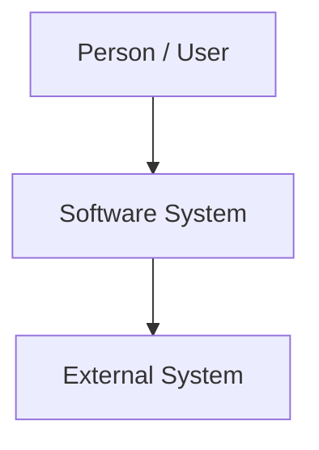
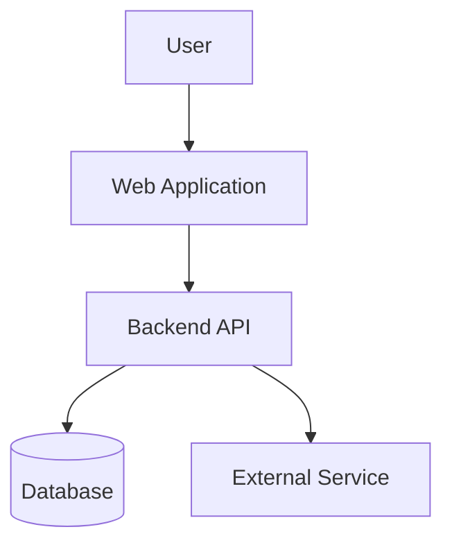

# C4 Architecture

## Document Control
| Field | Value |
|---|---|
| Project | [Project name] |
| Status | Draft / In Review / Approved |
| Version | 0.1 |
| Last updated | [Date] |

## 1. Architecture Overview
[Briefly describe the proposed system structure and key architectural drivers.]

## 2. Architecture Drivers
- Product goals:
- Key functional requirements:
- Key non-functional requirements:
- Constraints:
- Important trade-offs:

## 3. Level 1 — System Context
### System
[Name and responsibility of the system.]

### People
| Person / role | Description | Main interactions |
|---|---|---|
| [Role] | [Description] | [Interactions] |

### External Systems
| System | Purpose | Data exchanged | Ownership / dependency |
|---|---|---|---|
| [System] | [Purpose] | [Data] | [Details] |

### Context Diagram

[Replace the illustrative diagram with the actual system context.]

## 4. Level 2 — Container Diagram
| Container | Responsibility | Technology | Data store / interface |
|---|---|---|---|
| [Web app] | [Responsibility] | [Proposed / confirmed] | [Details] |
| [API] | [Responsibility] | [Proposed / confirmed] | [Details] |
| [Database] | [Responsibility] | [Proposed / confirmed] | [Details] |

## 5. Level 3 — Component Details (only if useful)
| Component | Container | Responsibility | Dependencies |
|---|---|---|---|
| [Component] | [Container] | [Responsibility] | [Dependencies] |

## 6. Key Data Flows
### [Flow name]
1. [Initiating actor/event]
2. [System action]
3. [External interaction, if any]
4. [Persistence / result]
5. [User-visible outcome]

## 7. Security and Trust Boundaries
- Authentication:
- Authorization:
- Sensitive data:
- Trust boundaries:
- Secrets and configuration:
- Audit requirements:

## 8. Deployment and Environments
| Environment | Purpose | Hosting / infrastructure | Notes |
|---|---|---|---|
| Development | [Purpose] | [Proposed / confirmed] | [Notes] |
| Staging | [Purpose] | [Proposed / confirmed] | [Notes] |
| Production | [Purpose] | [Proposed / confirmed] | [Notes] |

## 9. Architecture Decisions
| ID | Decision | Options considered | Rationale | Status |
|---|---|---|---|---|
| DEC-001 | [Decision] | [Options] | [Reason] | Proposed / Approved |

## 10. Risks and Open Questions
| Item | Impact | Follow-up |
|---|---|---|
| [Risk/question] | [Impact] | [Action] |

> Technology choices shown as proposed must not be treated as approved until the project owner confirms them.
