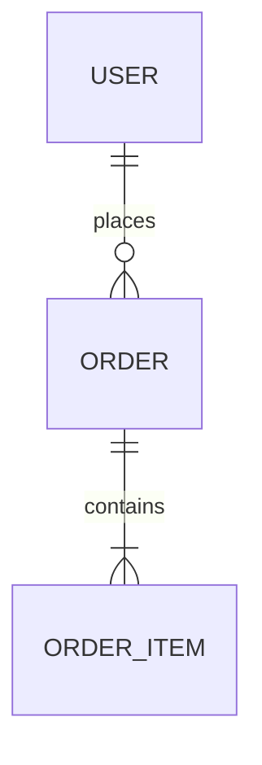

# Database Model

## Document Control
| Field | Value |
|---|---|
| Project | [Project name] |
| Database technology | [Confirmed / proposed / undecided] |
| Status | Draft / In Review / Approved |
| Version | 0.1 |
| Last updated | [Date] |

## 1. Modeling Overview
[Describe the domain and modeling approach. Explain whether this is conceptual, logical, or physical design.]

## 2. Entities
Repeat for each entity.

### [EntityName]
- **Purpose:** [What this entity represents]
- **Primary key:** [Field and type]
- **Attributes:**

| Attribute | Type | Required? | Default | Constraints / notes |
|---|---|---:|---|---|
| id | [Type] | Yes | [Default] | Primary key |
| [field] | [Type] | [Yes/No] | [Default] | [Rules] |

- **Relationships:** [Related entities and cardinality]
- **Lifecycle:** [Creation, updates, archival/deletion]
- **Sensitive data:** [If applicable]
- **Related requirements:** [FR IDs]

## 3. Relationships
| Entity A | Relationship | Entity B | Cardinality | Foreign key / notes |
|---|---|---|---|---|
| [Entity] | [Relationship] | [Entity] | 1:1 / 1:N / M:N | [Details] |

## 4. ER Diagram

[Replace illustrative entities and relationships with the actual domain model.]

## 5. Constraints and Integrity Rules
| Rule | Description | Enforcement |
|---|---|---|
| [Rule] | [Description] | Database / application |

## 6. Indexes and Query Considerations
| Table / entity | Fields | Index type | Query supported | Reason |
|---|---|---|---|---|
| [Entity] | [Fields] | [Type] | [Query] | [Reason] |

Only add indexes based on expected query patterns and constraints; avoid speculative indexing.

## 7. Data Lifecycle and Governance
- Creation and ownership:
- Update rules:
- Deletion / soft deletion:
- Retention:
- Audit history:
- Backup and recovery:
- Privacy / sensitive fields:

## 8. Seed and Reference Data
| Data set | Purpose | Source / maintenance |
|---|---|---|
| [Data] | [Purpose] | [Details] |

## 9. Open Questions and Assumptions
| ID | Item | Impact | Status |
|---|---|---|---|
| Q-001 | [Question or assumption] | [Impact] | Open / Assumption |

## 10. Traceability
| Entity / relationship | Related requirements | Workflow |
|---|---|---|
| [Entity] | FR-001 | UC-001 |
